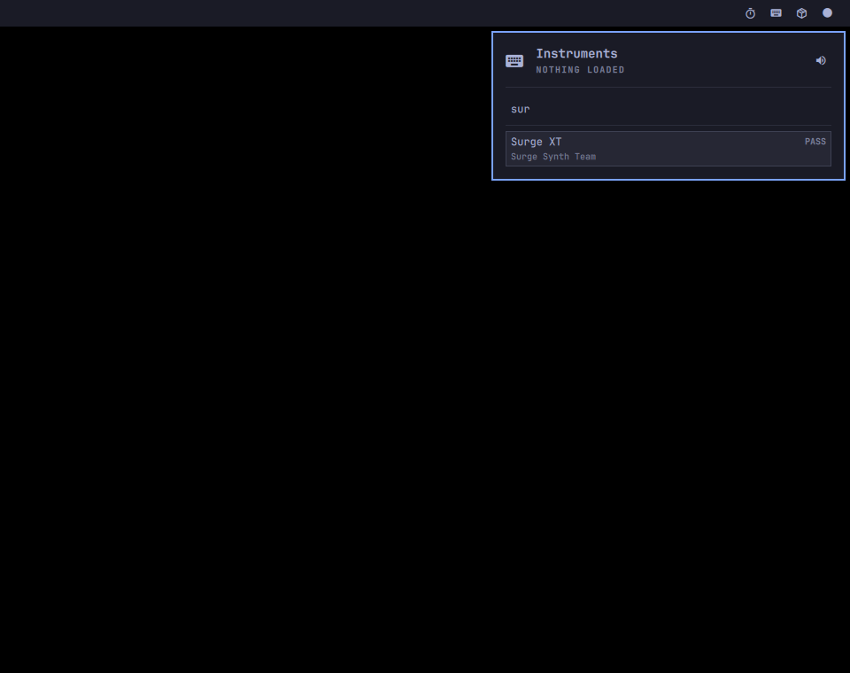
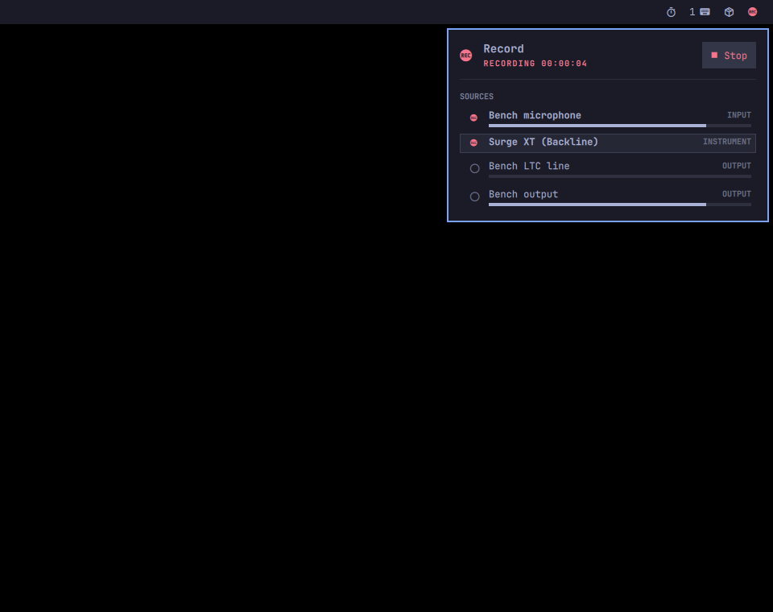
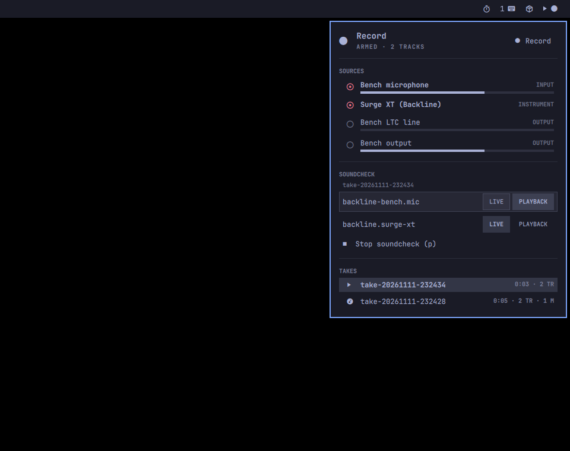
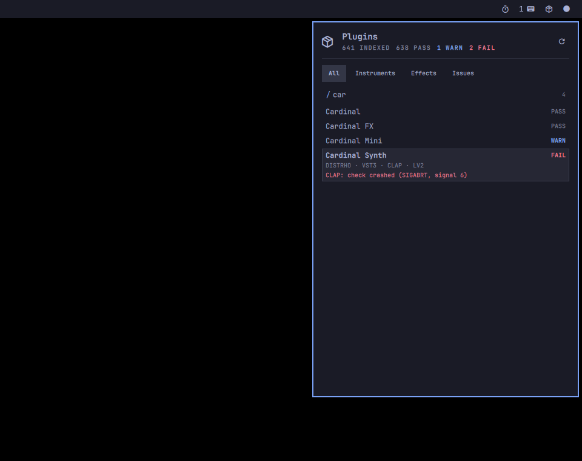
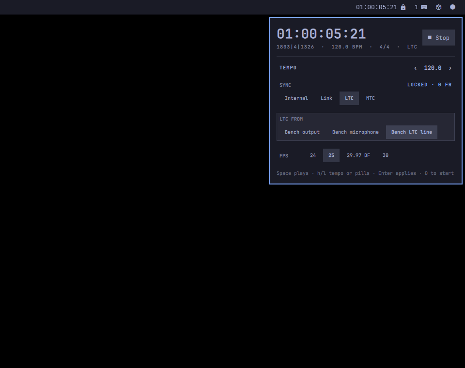
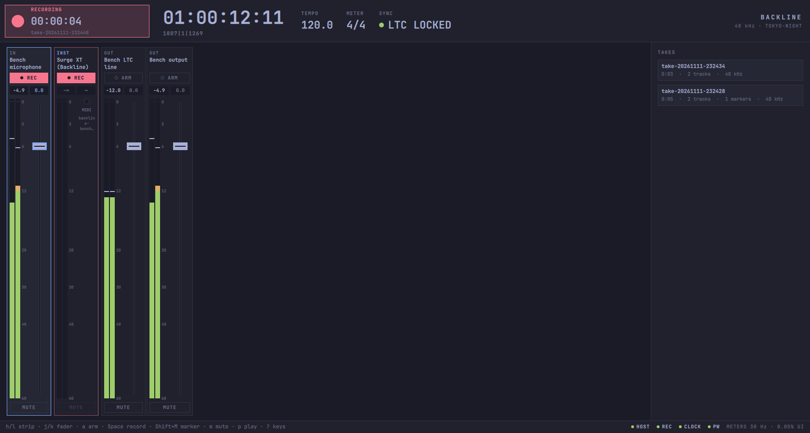

# Backline

**Mac-style pro audio for Omarchy Linux.** System instruments from any MIDI
keyboard, sample-aligned multitrack recording, files played on one shared
transport, an index of every installed plugin, and OSC/MIDI control of all
of it, as small PipeWire services with panels in the Omarchy bar.

> **Preview, not yet tested by the author on real hardware.** Everything here was proven with automated, measured tests on virtual devices (see `docs/proofs/`), but has not yet been run on real audio interfaces, MIDI controllers or a live session. Expect rough edges.

```sh
yay -S backline-audio && omarchy plugin add https://github.com/manuaudio/backline-audio --enable
```

> The AUR package is prepared but not published yet ([docs/AUR.md](docs/AUR.md)); until it
> is, [build from source](#build). Optional: `omarchy-backline-setup` adds Backline's
> menu rows and `Super + Ctrl` hotkeys, and asks first. Update with `omarchy plugin update
> io.github.manuaudio.backline` and `yay -Syu`; remove with `omarchy-backline-setup
> --uninstall`, `omarchy plugin remove io.github.manuaudio.backline` and `yay -R
> backline-audio` ([docs/OMARCHY-PLUGIN.md](docs/OMARCHY-PLUGIN.md)). The panels need
> Omarchy's Quattro shell (4.x with `ShellIpc`); the services and the `backline` command
> work on any Linux with PipeWire ≥ 1.4.

Under the panels, Backline is a set of system audio services for Linux,
built on PipeWire. It hosts audio plugins as ordinary PipeWire nodes, keeps an
index of every installed plugin, records any set of nodes to sample-aligned,
timestamped files, plays files on the shared timeline and maps control
surfaces to any parameter. Every piece is a small, separate process that apps,
the desktop shell and scripts can drive over D-Bus, OSC or a command line. It
covers the part of macOS's CoreAudio system layer, AudioComponent registry
and AUv3 hosting that Linux has no shared answer for yet.

> **Status: early, working slices; not a product.** The parts below are built,
> unit-tested and measured on a real PipeWire 1.6.8 system (see
> [Proofs](#proofs)). The D-Bus interfaces are 0.x (additive only within an
> interface). Changes per release are in [CHANGELOG.md](CHANGELOG.md).

The design and the reasoning behind it are in [ARCHITECTURE.md](ARCHITECTURE.md).
The choices that shape the project are in [docs/DECISIONS.md](docs/DECISIONS.md).

## What it does today

- **Run a plugin as a system instrument or effect.** Each instance runs as one
  process and one PipeWire node, with MIDI from any PipeWire MIDI source. It
  follows keyboards as they are plugged in, and you can set its parameters,
  play notes and save its state over D-Bus and OSC.
- **Survive plugin crashes.** A supervisor runs each instance in its own systemd
  user scope. If the plugin crashes, it comes back in about 80 ms with the
  same parameters, node name and OSC port, and keeps playing. A crash loop
  backs off and then stops. Nothing else in the graph is affected.
- **Know what's installed.** One scan finds every CLAP, VST3 and LV2 plugin.
  Each plugin is probed in its own sandboxed process with a time limit, so
  crashes and hangs are contained. It is graded pass, warn or fail, and the
  results are cached by mtime and SHA-256. You can query the index over D-Bus
  or as JSON.
- **Record several nodes in one take, sample-aligned.** Output is WAV/BWF or
  FLAC, with a BWF time reference and a JSON sidecar. Tracks stay aligned
  even when one of the recorded sinks drives the graph, and there is a
  pre-roll so a take never misses its first notes. As a D-Bus service it arms,
  records, stops, lists takes and sets markers; takes past 4 GB become RF64;
  hardware input latency is compensated; a stalled disk loses nothing within
  the ring (30 s by default); and a take plays back in place of its inputs
  for a virtual soundcheck, input by input.
- **One transport for the whole system.** The clock service owns PipeWire's
  transport and bar (JACK apps see it as the JACK transport), generates and
  chases LTC and MTC to the sample, and joins an Ableton Link session.
  Hosted plugins follow it: CLAP transport, VST3 `ProcessContext` and LV2
  `time:Position`, so a tempo-synced arpeggio or delay locks to the clock.
- **Play files on that timeline.** Each file starts on an exact transport
  frame (frames, timecode or bar/beat), with its own gain, and follows play,
  stop and locate; every sample lands where the timeline says.
- **Control it all from a surface.** MIDI CC, notes and OSC mapped to plugin
  parameters, volumes, the transport and the recorder, with MIDI and OSC
  learn. No network socket unless you ask for one; beyond localhost only with
  an allow-list, and TCP only with a shared secret.
- **Motor faders for any program** (new, not yet tested on real hardware).
  A program publishes its parameters (`Params1`) and pushes views of channel
  strips; Mackie Control surfaces (X-Touch and Extender, MCU Pro and XT) bank,
  flip, show names, colours and meters, and follow touch, through
  `backline-surfaced` (`Surface1`). OSC tablets subscribe to the same tree;
  generic MIDI boxes get 14-bit CC, NRPN, relative encoders, soft takeover
  and feedback.

## On the desktop: Omarchy panels and a mixer

On [Omarchy](https://omarchy.org), Backline lives in the desktop's own workflow:

- **One Omarchy plugin, four bar panels:** Instruments, Record, Plugins and Transport, side by side in one bar slot, installed with `omarchy plugin add`. They're built from Omarchy's own shell components and theme tokens.
- **`omarchy-backline-*` commands.**
- **Menu rows** in the Omarchy menu and **`Super + Ctrl` hotkeys**, added by `omarchy-backline-setup` when you agree.

A larger **mixer window** has a channel strip with a live meter for every input, instrument and output, plus the transport and the takes. It follows the Omarchy theme and language live. Every job takes a few keystrokes, measured end to end against the real services.

| Play an instrument | Record a set | Soundcheck | Check a plugin | Lock to timecode |
|---|---|---|---|---|
|  |  |  |  |  |
| 6 keys first time, 3 again | 5 keys; 1 from anywhere after | 3 keys | 6 keys, no Enter | 6 keys first time, 4 again |



Measured:

- **Meter latency:** a key press on a MIDI keyboard reaches the meter's pixel in 21–39 ms (median, over two runs). Of that, the mixer's own part is 16–18 ms; the rest is the MIDI bridge, the plugin and the graph.
- **Mixer CPU:** about 5% of one core while metering.
- **Closed panels:** they start no processes.

See [omarchy/README.md](omarchy/README.md) (panels, commands, menu, hotkeys, install), [ui/README.md](ui/README.md) (the mixer), [ui/UX-FLOWS.md](ui/UX-FLOWS.md) (the jobs, key by key) and [ui/DESIGN-LANGUAGE.md](ui/DESIGN-LANGUAGE.md) (the look). The screenshots are from the flows test, which runs on a private headless compositor with a stand-in bar.

## Components

| Component | What it is | State |
|---|---|---|
| `backline-plugin-worker` | One CLAP, VST3 or LV2 plugin as one PipeWire node, in its own process. MIDI in (follows hotplugged keyboards, releases stuck notes on unplug), audio in/out, params, notes, state and presets over D-Bus ([`Instance1`](docs/api/Instance1.md)) and localhost OSC | Built, measured |
| `backline-hostd` | The supervisor (D-Bus `Host1`). It runs one worker per instance in a transient systemd user scope with resource limits. After a crash it restarts the worker with the saved plugin state (CLAP, VST3 or LV2), with backoff and a give-up limit. It refuses plugins the registry grades `fail` unless forced | Built, measured |
| `backline-registry` + `backline-probe` | The plugin index (D-Bus `Registry1`, JSON `backline.plugins/1`). Each plugin is probed in its own process, sandboxed with timeouts, then graded and cached | Built, measured |
| `backline-recorder` | N nodes into one take: WAV float/24-bit (RF64 past 4 GB) or FLAC, BWF `bext`, markers as cue points, a sidecar with UTC, monotonic and graph timestamps. Signal alignment across driver and follower sinks, input-latency compensation, pre-roll | Built, measured |
| `backline-recorderd` | The recorder as a D-Bus service ([`Recorder1`](docs/api/Recorder1.md)): arm, record, stop, markers, takes, a disk thread behind large rings, and virtual soundcheck (a take played back as its inputs, switched per input) | Built, measured |
| `backline-clockd` | Transport, tempo and meter as PipeWire's position segment ([`Clock1`](docs/api/Clock1.md)), LTC and MTC generate and chase, Ableton Link (in its own process: Link is GPL) | Built, measured |
| `backline-controld` | OSC and MIDI mapped to any parameter ([`Control1`](docs/api/Control1.md)): plugin parameters, volumes and mutes, filter-chain controls, transport and recorder; MIDI and OSC learn. Opens no network socket unless asked; beyond localhost it needs an allow-list, and TCP a shared secret | Built, measured |
| `backline-surfaced` | Control surfaces for any program ([`Surface1`](docs/api/Surface1.md)) over the parameter trees programs publish ([`Params1`](docs/api/Params1.md), served by controld): MCU-family detection and handshake, groups of units, views, banking, layers, flip, motor faders, scribble strips, meters, hot-plug | Built, tested against software devices; real hardware pending ([checklist](docs/HARDWARE-TEST.md)) |
| `libbackline` | The MIT C client library (sd-bus only, no PipeWire dependency): `Host1`, `Instance1`, `Registry1`, `Recorder1`, `Clock1`, `Player1` and `Control1` calls and a signal watcher | Skeleton, used by the CLI |
| `backline` | The command line over `libbackline`; `--json` on every command | Built |
| `backline-playerd` | Files played into the graph on the shared timeline ([`Player1`](docs/api/Player1.md)): one node per file, a start on an exact transport frame (frames, `tc:`, `bbt:`), per-file gain, streaming past an in-memory head | Built, measured |
| QML module | A Qt Quick module over `libbackline` | Design only ([ARCHITECTURE.md](ARCHITECTURE.md)) |

In-graph CLAP effects (a plugin inside PipeWire's filter-chain, for device
effects) are a separate project,
[clap-pipewire](https://github.com/manuaudio/clap-pipewire).

## Build

You need PipeWire ≥ 1.4 development headers (1.6 is preferred: the worker
then uses the newer pod parser), plus libsystemd, libsndfile, alsa-lib,
json-c, OpenSSL's libcrypto, and optionally lilv (for LV2) and the VST3 SDK
3.8 (for VST3; MIT; Arch: `vst3sdk`, found through pkg-config, or point
`-DBACKLINE_VST3SDK_DIR=` at an unpacked SDK). Without them the worker is
built without that format (`-DBACKLINE_VST3=OFF`, `-DBACKLINE_LV2=OFF` to
force it). You also need CMake ≥ 3.20 and a C11/C++20 compiler. The CLAP
headers are vendored (MIT).

```sh
# Arch
sudo pacman -S --needed base-devel cmake ninja pipewire libsndfile alsa-lib json-c lilv openssl vst3sdk
# Debian 13 / Ubuntu 25.04+
sudo apt install build-essential cmake ninja-build pkg-config libpipewire-0.3-dev libsystemd-dev \
  libsndfile1-dev libasound2-dev libjson-c-dev liblilv-dev libssl-dev

cmake -S . -B build -G Ninja
cmake --build build
ctest --test-dir build        # unit tests: no PipeWire daemon or session bus needed
```

## Try it

Run the services from the build tree. Nothing is installed, and nothing
touches your default devices.

```sh
build/backline-hostd &                                   # the supervisor, on the session bus
build/backline host load "Surge XT" --id synth           # plays to your default output (DECISIONS D2)
build/backline params synth volume                       # find parameters
build/backline set synth "Global Volume" 0.5
build/backline note synth on 60 100; sleep 1; build/backline note synth off 60
build/backline --json host show synth                    # pid, node, OSC port, scope, state file
build/backline host watch                                # Loaded / Crashed / Restarted / Failed
build/backline host presets synth                        # CLAP preset-discovery, .vstpreset, LV2 presets
build/backline host preset synth "Attacky"
build/backline host unload synth
build/backline host load "Dexed" --format vst3 --id dx   # a VST3 bundle by name (or a path)
build/backline host load https://thewavewarden.com/odin2 --id odin   # an LV2 plugin by URI

build/registry/backline-registry scan                    # index ~/.clap ~/.vst3 ~/.lv2 and the system dirs
build/backline plugins list --kind instrument --grade pass

build/backline rec -s <sink-or-node> -o takes -d 10      # or -P 5 for 5 s of pre-roll, then: kill -USR1

build/clock/backline-clockd &                            # the transport
build/player/backline-playerd &                          # files on its timeline
build/backline play load song.wav --at 'bbt:5|1|0' --gain -3
build/backline transport play
build/control/backline-controld &                        # OSC/MIDI mapping (no network socket unless asked)
build/backline map learn 'instance:backline.surge-xt/Global Volume'   # then move a knob
```

To play from a hardware keyboard, add
`--midi-follow 'Midi-Bridge:.*(capture)'` to `host load`. The worker links
every matching MIDI source, now and whenever one is plugged in.

## Proofs

Each component has a script in `tests/` that builds a throwaway test graph:
null sinks owned by the script, nothing linked to real devices. The script
measures what the component claims, then checks that the default sink and
every other node are unchanged. The reports from the development machine are
in [`docs/proofs/`](docs/proofs/).

| Proof | What is measured | Result (2026-11-11) |
|---|---|---|
| [`host-proof`](docs/proofs/host-proof.txt) | Surge XT played by a virtual keyboard through PipeWire's MIDI bridge; a live parameter over OSC/D-Bus; SIGKILL one of two instances | Pitch within 0.12 cent by FFT. The parameter took effect in ≤ 27 ms. The survivor was unchanged and gap-free across the kill |
| [`hostd-proof`](docs/proofs/hostd-proof.txt) | hostd + CLI: three parameters moved, SIGKILL while a keyboard plays, crash loop, registry gate | All 775 parameter values identical after the restart. Restarted ≈ 80 ms after the kill. Level and pitch identical (±0.00 dB, ±0.00 cent), and every later note sounds. Backoff 0/250/500/1000/2000 ms, then `Failed`. A `fail`-graded plugin was refused, and when forced it left no processes |
| [`formats-proof`](docs/proofs/formats-proof.txt) | VST3 (Surge XT, Dexed, Dragonfly) and LV2 (Odin2, CHOW Tape Model) in the worker: keyboard notes, OSC/D-Bus parameters, effects on a test signal, presets in all three formats, SIGKILL under hostd | Pitch within 0.12 cent in both formats. Reverb tail and tape harmonics measured. 2 986 CLAP, 32 VST3 and 94 LV2 presets listed; a load changes the sound in each format. After SIGKILL, every parameter value back (VST3 at 32-bit float precision, LV2 exact) and the same level and pitch |
| [`registry-proof`](docs/proofs/registry-proof.txt) | Full scan of `~/.clap`, `~/.vst3` and `~/.lv2`, plus crash and hang test plugins | 645 plugins in 13.4 s cold (10 s of that is the hang plugin's timeout) and 1.6 s warm. The crash (SIGSEGV) and the hang were graded fail, and their helper processes were killed |
| [`recorder-proof`](docs/proofs/recorder-proof.txt) | One signal into two sinks, one of them the graph driver, at quantum 2048 and 256; pre-roll | Bit-identical tracks at lag 0, where raw graph alignment is off by exactly one quantum. The pre-roll take is identical to the matching stretch of a reference take |
| [`recorderd-proof`](docs/proofs/recorderd-proof.txt) | The D-Bus recorder: API and markers; input-latency compensation with fake devices of known latency; 12 s and 8 s disk stalls during a 40 s take; virtual soundcheck and a crash while switched | Each track lines up by exactly its latency. 0 frames lost to the stalls (every frame equals an unstalled reference). Playback bit-exact and in lockstep; links restored, even after SIGKILL |
| [`rf64-proof`](docs/proofs/rf64-proof.txt) | A live 16-channel take of 1460 s (4.2 GiB in one file), with an independent second recorder | A valid RF64 file (ds64 sizes match), bext and cue markers intact, 0 ring overruns. All 70 080 000 frames continuous and identical to the reference, 0 missed cycles (quantum 1024, own driver, other agents' work at load ≈ 2; see the report) |
| [`rescan-proof`](docs/proofs/rescan-proof.txt) | The shipped rescan units verified; the same watch as a transient unit over throwaway plugin directories | An install, a pacman-style stamp and a removal each rescan once, ≈ 2.1 s after the change |
| [`controld-proof`](docs/proofs/controld-proof.txt) | MIDI CC and OSC to a plugin parameter, the transport, the recorder, a sink's volume and mute; MIDI and OSC learn; the network rules, in its own network namespace | No socket by default; 8 unsafe listeners refused. A CC lands on exactly the value D-Bus would set (0.00 dB apart), 5-7 ms from keyboard to sound. Volume exact to 0.001 dB. Wrong secrets, peers off the allow-list, malformed packets and floods change nothing |
| [`surfaced-proof`](docs/proofs/surfaced-proof.txt) | Params1 over D-Bus and OSC with a stub mixer; Control1's 14-bit CC, NRPN, relative encoder, takeover and feedback with a software controller; surfaced with a software X-Touch and Extender as one 16-strip group, on a private PipeWire instance | 82 checks. A touched fader reaches the program within one graph cycle (0.7-5.3 ms), untouched moves never; motors follow the program; banking, layers, flip, pots, meters, displays; an unplug while a fader is held ends its gesture within 50 ms and a replug returns the unit to its place |
| [`player-proof`](docs/proofs/player-proof.txt) | Two files on clockd's timeline (one at a frame, one at `bbt:3\|1\|0`, −6 dB) into native capture nodes; play, locates while rolling and stopped, a gain change; at quantum 128 and 1000 | Every received sample bit-identical to the file at (transport − start) × gain (1.8 M samples per run; only the one gain-ramp cycle differs). Each start on its exact frame, on a cycle boundary or inside a cycle. 0 underruns |
| [`transport-proof`](docs/proofs/transport-proof.txt) | Beat-click test plugins (CLAP, VST3, LV2) and Odin2's arpeggiator in the worker while clockd changes tempo and meter, locates and stops | Every click on the sample PipeWire's transport gives (0 samples off clockd's tempo map for CLAP and VST3, 0–1 for LV2). Odin2's steps on clockd's grid at 120 and 90 BPM in all three formats, with Odin2's own constant lead |
| [`clockd-proof`](docs/proofs/clockd-proof.txt) | Transport and bar seen by a native PipeWire node; LTC/MTC generate and chase (25, 29.97 DF, 24, 30 fps), through a sink monitor and a jump; Link with a second peer | Frames and bar exact to the tick. LTC/MTC frame starts within 2 samples (0 at 25/30 fps); chase locked in 37-75 ms with 0 samples of error. Link: tempo both ways, beat phase within 0.63 ms |

```sh
tests/host-proof; tests/hostd-proof; tests/formats-proof; tests/registry-proof; tests/recorder-proof
tests/recorderd-proof; tests/rf64-proof; tests/clockd-proof; tests/rescan-proof; tests/controld-proof
tests/player-proof; tests/transport-proof; tests/surfaced-proof
```

The proofs need a running PipeWire (≥ 1.4) with WirePlumber, a systemd user
session, `pw-cli`, `pw-play`, `pw-record`, `jq`, `busctl`, `python3` and
`metaflac`. `host-proof`, `hostd-proof` and `controld-proof` also need Surge
XT (CLAP) in `~/.clap` or `/usr/lib/clap`; `controld-proof`,
`clockd-proof` and `surfaced-proof` run in their own user and network namespace (`unshare -rn`,
`ip`, `ss`). `formats-proof` needs Surge XT (CLAP, VST3),
Dexed, Dragonfly Hall Reverb (VST3), Odin2, CHOW Tape Model and Cardinal
(LV2) in the user plugin directories.

## Limits (as of now)

- **Formats.** CLAP, VST3 and LV2 run in the worker. The registry still
  grades VST3 on loading only. LV2 parameters are control ports only, not
  `patch:Parameter` (so Surge XT's LV2 shows two). Presets are saved only
  for VST3 (`.vstpreset`).
- **No plugin GUIs.** Hosted plugins get the clock's transport, but a meter
  change made while rolling doesn't renumber the bars before it (no full
  multi-meter map yet).
- **The clock follows PipeWire's driver.** Its transport is the driver's: run
  clockd in the graph whose transport you want. Two clockds under one driver
  fight over it. The bar's beat is exact to the frame (clockd sets the bar
  offset below PipeWire's 1/1920-beat tick).
- **State is whatever the plugin saves.** hostd restores the plugin's state;
  a plugin that leaves something out of its state loses it on a restart. A
  note held at the moment of a crash is cut, and the next note-on sounds.
- **Recorder alignment** follows PipeWire's scheduling, as measured: a sink
  that drives the graph is one cycle late on its monitor. It holds through
  quantum and driver changes, but the cycle where the driver changes can
  glitch on that track. Hardware capture latency is compensated from what the
  device reports (measured with fake devices, not yet against a real
  converter's measured round trip).
- **Virtual soundcheck moves links.** A consumer's links from an input are
  moved to the playback node and put back on live (also after a crash, on the
  next start). A session manager that re-links a stream while the input is in
  playback is undone each time; no resampling if the take's rate differs.
- **The player plays a file only at the graph's rate** (no resampling yet;
  such a clip stays silent and says so), has no loops or cue lists, and a
  locate into the streamed part of a file while rolling can leave a cycle of
  silence while its ring refills.
- **Realtime scheduling was off** in the proofs (no rtkit on the test machine).
  They pass at quantum 128 anyway, but this is not a latency benchmark.
- **Probes run with your real `$HOME`.** A plugin can write its own settings
  while it is scanned; the registry flags files written to the working
  directory, not to `~/.config`.

## Licence

MIT; see [LICENSE](LICENSE). The vendored `third_party/clap` is free-audio/clap
(MIT).

Everything Backline exposes stays MIT: the C library, the CLI and the D-Bus
API. GPL components that Backline uses (Ableton Link, compiled into
`backline-clockd`, which makes that one binary GPL-2.0-or-later; Carla's bridges for odd plugin formats) run in their own processes
and are reached over IPC only. **That boundary is a design choice to keep the
licensing simple, not legal advice**; see
[docs/DECISIONS.md](docs/DECISIONS.md) (D3).

## How this was made

Backline is developed with AI assistance (Anthropic's Claude, working in
Claude Code) under human direction. The code, the tests and the proofs in
this repository were written that way. The proofs exist so that claims are
measured, not just asserted. Bug reports with a reproducer are very welcome.
