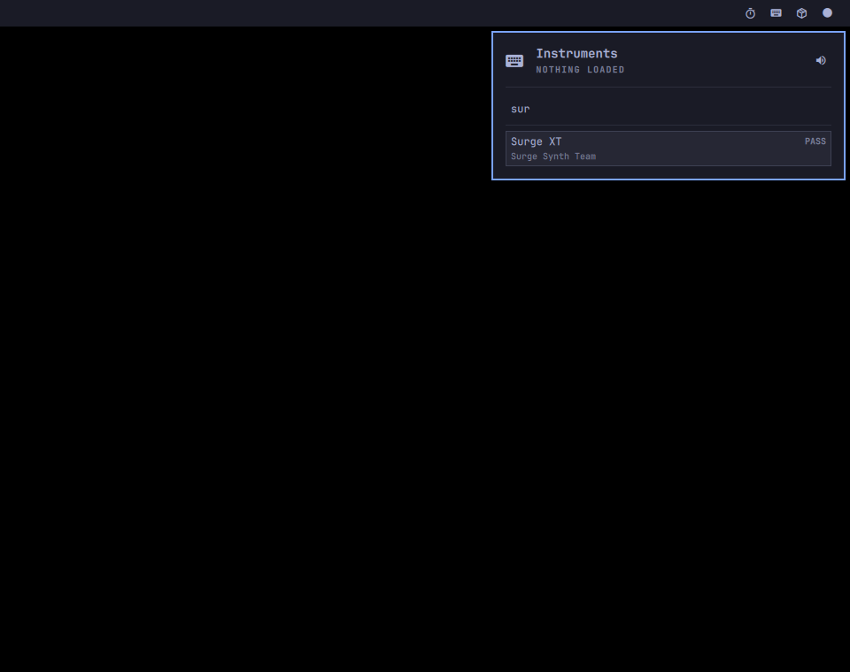
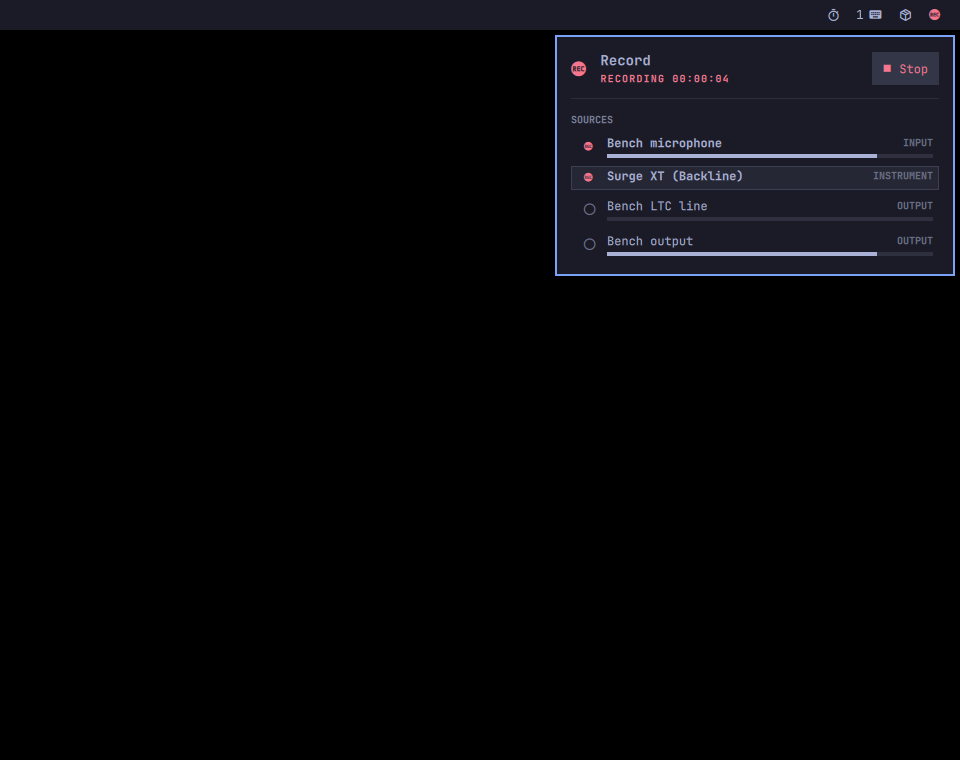
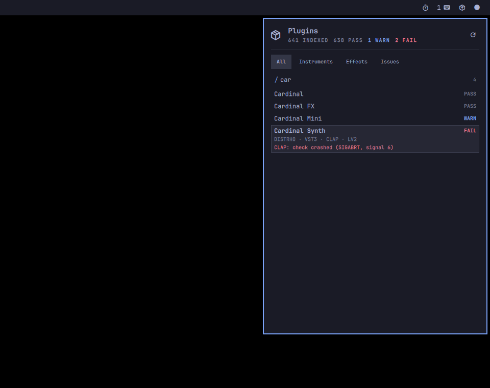
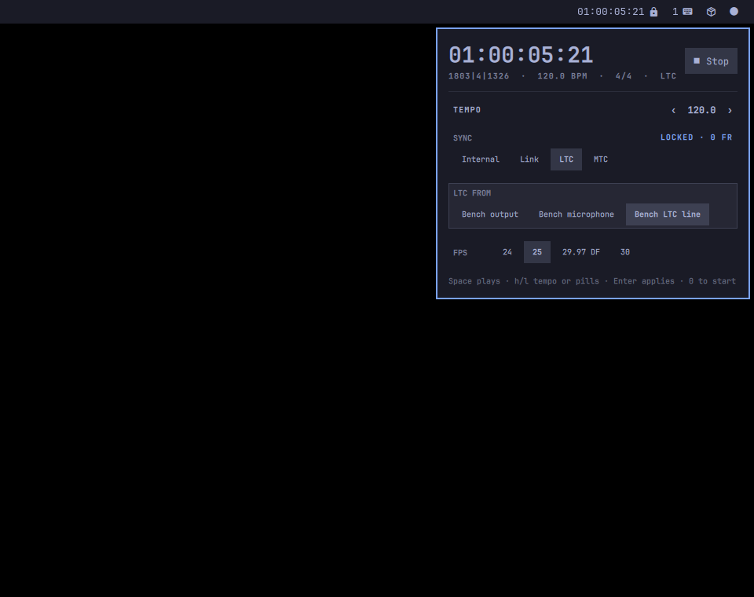

# Backline in Omarchy

Backline's everyday jobs live inside Omarchy's own workflow. There are four bar panels, `omarchy-backline-*` commands in Omarchy's command style, rows in the Omarchy menu, and `Super + Ctrl` hotkeys on the planes Omarchy gives them. Everything is built from Omarchy's shell components and theme tokens, so it follows the current theme and language the way Omarchy's own panels do.

| Instruments | Record | Plugins | Transport |
|---|---|---|---|
|  |  |  |  |

The jobs, and the fewest keystrokes for each (measured), are in [`ui/UX-FLOWS.md`](../ui/UX-FLOWS.md). In short:

| Job | Keys |
|---|---|
| play an instrument from a keyboard, first time | `Super+Ctrl+I` `Enter` `s u r` `Enter`: 6 |
| the same, again | `Super+Ctrl+I` `a` `Enter`: 3 |
| record a set, first time (two sources) | `Super+Ctrl+M` `Space` `j Space` `r`: 5 |
| record, from anywhere, again | `Super+Ctrl+Alt+M` to start, and again to stop: 1 each |
| virtual soundcheck: one input on playback | `Super+Ctrl+M` `p` `l`: 3 |
| check a plugin | `Super+Ctrl+I` `Tab` `/` `c a r`: 6, with no `Enter`; the grade and the finding are on the row |
| lock to timecode, first time | `Super+Ctrl+G` `l l` `Enter` `j` `l`: 6 |
| lock to timecode, again | `Super+Ctrl+G` `l l` `Enter`: 4 |
| open the mixer | `o` in any Backline panel |

## What's here

| Path | What |
|---|---|
| `plugins/backline.{instruments,record,plugins,transport}/` | the four shell plugins: `manifest.json`, `Panel.qml`, and the shared `Model.js` and `i18n/` (links here, copied in on install) |
| `plugins/shared/Model.js` | the panels' pure logic: picker order, filters, grades, sources, timecode, status tones |
| `bin/omarchy-backline-*` | commands: `instrument-add`, `instrument-remove`, `instrument-midi`, `record`, `soundcheck`, `transport`, `plugins-scan`, `mixer`, and the panels' `state` and `watch` |
| `lib/omarchy-backline.sh` | their shared D-Bus, MIDI and catalog helpers |
| `i18n/en.json` | the commands' notification and prompt strings |
| `extensions/omarchy-menu.jsonc` | the menu rows (Trigger › Backline) |
| `hypr/backline.lua` | the hotkeys |
| `install` | installs it all for the current user; `--uninstall` takes it out again |
| `dev/` | the bench, the headless compositor and the flows (below) |
| `test/` | tests in Omarchy's shape |

## How it follows Omarchy

The rules are from Omarchy's `AGENTS.md`, `agents/skills/shell-dev.md`, `docs/menu.md`, `docs/i18n.md` and the hotkeys manual (`quattro`, read 2026-11-11).

**Panels.**

- Each panel is `Panel` with `KeyboardPanel { content: PanelKeyCatcher { … } }`, so it's built on first open.
- There is one cursor model shared by keyboard and mouse. Hover moves the cursor; visuals come from `hasCursor`/`current` through `CursorSurface`.
- Keys: `j`/`k` and the arrows move, `h`/`l` move along pills or adjust, `Enter`/`Space` act, `x` removes, `Esc` closes, and `Tab` goes to the next panel.
- Only Omarchy's components are used: `PanelSectionHeader`, `PanelSeparator`, `Button` pills, `PanelActionButton`, `FilterInput`, `BarIconButton`. Colours come from `Commons.Color` and `Style`; there are no hard-coded colours.
- Each plugin answers its own IPC target (`backline.instruments`, …) with `refresh` and a `state` the tests read.
- Repeater rows are primitive snapshots, never `PwNode`s.
- Strings come from `Commons.Translations` with the plugin's own catalog. Every `Text` declares `textFormat`.
- All four pass Omarchy's `omarchy-plugin-validate`.

**No polling.**

- A panel reads its state once on open.
- While open, it follows the services' D-Bus signals through `omarchy-backline-watch`, an event stream run only then.
- A closed panel runs nothing. The exceptions are Record during a take or soundcheck and Transport while rolling or chasing, which keep the bar icon true. Otherwise a closed panel re-reads only when a Backline node appears or goes in PipeWire (a load, a crash, a restart), or on a push from a command.
- Measured: with every panel closed, the shell starts no processes and uses 0.1% of a core.

**Commands.**

- `#!/bin/bash`, `omarchy:summary`/`args` metadata, and a comment saying why the command exists and what it doesn't do.
- Notifications go through `omarchy-notification-send` with glyphs and translated text.
- Pickers use `omarchy-menu-select`.
- After a change, a command pushes `omarchy-shell -q <panel> refresh`.
- Choices are remembered under `~/.local/state/backline/omarchy/`.
- No sudo, and the default devices are never changed.

**Menu.** Rows live in the user's menu extension, with cheap `when` guards: a process check, or one D-Bus property read that never starts a service. There are no aliases.

**Hotkeys.**

- `Super + Ctrl + I`, `M`, `G` open panels, on the panels plane.
- `Super + Ctrl + Alt + M`, `G` are their quick-action variants (record or stop; play or stop), as `Super + Ctrl + Alt + C` is to the capture menu.
- All five keys are free in Omarchy's defaults.

**Third-party, not first-party.** This installs as a third-party plugin set under `~/.config/omarchy/plugins/`, with its own commands and catalogs. The `backline` command group isn't in Omarchy's `GROUP_DESCRIPTIONS`. Proposing any of it to Omarchy itself would follow `ARCHITECTURE.md` §5.8: one problem per PR, with the measured evidence.

## Install

The panels need Omarchy's quattro shell (the plugin API with `ShellIpc`, `FilterInput`, `Commons.I18n` and `Commons.Translations`). A 4.0.0 alpha install predates it, and the panels won't load there; the commands, menu rows and mixer don't depend on it.

```sh
cmake -S ui -B ui/build && cmake --build ui/build    # the mixer (optional)
omarchy/install                                       # asks before adding hotkeys; --yes, --no-hotkeys, --no-menu
omarchy/install --uninstall
```

The panels start in the bar's right section, in the order Instruments, Plugins, Record, Transport. `Tab` moves between neighbours. Arrange them with `omarchy bar move`.

## Tests

Tests run in Omarchy's style: `pass`/`fail` TAP lines, a stubbed world, and the real code.

| Test | What it covers |
|---|---|
| `test/model-test.sh` | the panels' model in Node: picker order, filters, MIDI pills, plugin findings, sources, drop-frame timecode, chase status |
| `test/commands-test.sh` | the commands against stubbed `busctl`, `pw-dump` and `backline`, in a fake HOME: MIDI matches checked as the worker's regex, picker order and ids, the fail-grade refusal, arming and re-arming, notifications in pt-BR → pt → English |
| `test/i18n-test.sh` | the catalogs are current, every key is used and exists, and every `Text` has a `textFormat` |
| `test/install-test.sh` | the installer in a fake HOME: the menu is merged and parsed by Omarchy's own `MenuModel.js`, the user's rows and bindings are kept, a rerun is idempotent, and uninstall restores each file byte for byte |

End to end:

- `dev/flows` drives every flow of [`ui/UX-FLOWS.md`](../ui/UX-FLOWS.md) with real key presses into the real panels. It runs on a private headless compositor (`dev/headless`) against the real services on throwaway devices (`dev/bench`), times each step, and takes the screenshots. Report: [`test/flows-report.txt`](test/flows-report.txt).
- The bench never touches the live desktop. It uses its own session bus, its own Quickshell instance and stubbed desktop helpers. Its nodes are `backline-bench.*`, in their own node group. A watchdog stops it the moment anything of it links to a real device.
