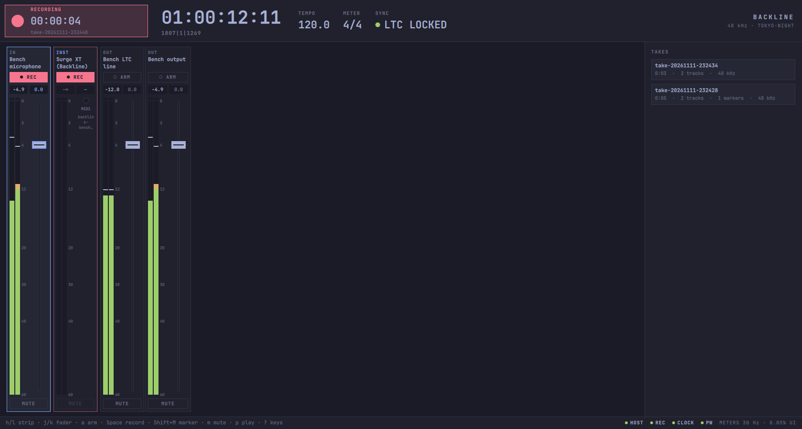

# backline-mixer

The larger window for Backline: every channel strip (inputs, Backline instruments and outputs) with a live meter, plus the transport and timecode, the takes and the virtual soundcheck. It opens from any of the Omarchy panels (`o`), from the menu, or from the app launcher. It follows the Omarchy theme and language live.



It's built the way Omarchy's own apps are (the `omarchy-app` skill): C++ and Qt Quick, one binary, keyboard first, and themed from Omarchy's files. [`UX-FLOWS.md`](UX-FLOWS.md) has the jobs and their keystrokes, and [`DESIGN-LANGUAGE.md`](DESIGN-LANGUAGE.md) has the look and where it comes from.

## Build, run, test

```sh
cmake -S ui -B ui/build && cmake --build ui/build
ui/build/backline-mixer
cd ui/build && QT_QPA_PLATFORM=offscreen ctest --output-on-failure   # C++ and QML tests
ui/tests/measure                                                       # CPU and meter latency, on the bench
```

It needs Qt 6 (base, declarative), libpipewire 0.3, and Backline's services on the session bus. Without them it still runs: it shows what is missing, and starts the recorder and clock through D-Bus activation on first use.

## Keys

| Key | |
|---|---|
| `h` / `l` | previous / next strip |
| `j` / `k` | fader down / up 1 dB |
| `Tab`, `Enter` | the next control on the strip (arm, fader, mute); press it |
| `a` | arm or disarm the strip |
| `Space` | record the armed strips, or stop |
| `Shift + M` | marker in the take |
| `m` | mute the strip |
| `[` / `]`, `0` | fader 1 dB down / up; 0 dB |
| `c` | clear the clip lamps |
| `p`, `Home` | play or stop the transport; back to the start |
| `?` | every key |
| `q` | quit |

With the mouse:

- click a strip to select it;
- click **ARM** or **MUTE**;
- drag the fader, use the wheel (1 dB steps), or double-click it (0 dB);
- click the record lamp;
- click a take to soundcheck it, and **LIVE**/**PLAYBACK** per input.

## How it's built

| File | Job |
|---|---|
| `src/graph.{h,cpp}` | PipeWire: the nodes worth a strip, and one passive peak tap per metered node. A device's tap is a capture stream on it, with `node.dont-fallback`, so it never records the default device by mistake. An instrument is an output stream, which WirePlumber won't take as a capture target, so its tap links itself to the instrument's main outputs with non-lingering links. The data thread does one pass per buffer and two atomic stores. |
| `src/meter.{h,cpp}` | `MeterBank`: one 30 Hz timer, only while the window is visible. `MeterItem`: ballistics (instant attack, 24 dB/s release, 1.5 s hold, clip latch), drawn as one scene-graph geometry node with per-vertex colour. It isn't redrawn when nothing moved. |
| `src/services.{h,cpp}` | D-Bus, all asynchronous: `Host1` and `Instance1` for the instruments, `Recorder1` for arm, record, markers, takes and soundcheck, and `Clock1` for the transport and lock (per `docs/api`). It follows signals and `PropertiesChanged`. The only poll is the instruments' MIDI counter, at 5 Hz while visible. The armed set is the same file the panels use, so arming in one arms in both. |
| `src/theme.{h,cpp}` | The Omarchy theme as tokens, followed live, plus the `design.json` slot |
| `src/translator.{h,cpp}` | Omarchy's language, from the `omarchy-app` template |
| `src/qml/` | the window: `Main.qml` (layout, cursor, keys), `TopBar.qml`, `ChannelStrip.qml`, `SidePanel.qml`, `HelpOverlay.qml`, and `Strips.js` (pure helpers) |

## Proofs

These were measured on the bench: the real services and throwaway devices, in a private headless compositor, rendered on the GPU. The full numbers are in [`tests/measure-report.txt`](tests/measure-report.txt).

**Meter latency, key to pixel.** A virtual keyboard played 40 notes into Surge XT, timed from the note-on to the presented frame that shows it. The mixer's own part is steady. The graph's part (MIDI bridge, plugin, graph cycles) varied with what else the machine was running, so two runs are shown:

| Stage | Run 1, median / p95 | Run 2 (committed report), median / p95 |
|---|---|---|
| key to tap (MIDI, plugin, graph) | 2.7 / 7.9 ms | 22 / 41 ms |
| tap to frame (the mixer: the 30 Hz tick and the render) | 18 / 32 ms | 16 / 32 ms |
| total, key to frame | 21 / 36 ms | 39 / 63 ms |

The mixer adds at most 34 ms: one meter tick plus one frame.

**CPU.**

| Case | Share of one core |
|---|---|
| mixer, every strip metering a moving signal | 4.7–5.4% |
| of which the meter tick itself | 0.3–0.35% |
| mixer, silent graph | 0.5–0.7% |
| Quickshell, with the Record panel open (Quickshell's own meters) | 3.4–3.9% |
| Quickshell, with every panel closed | 0.1%, and it starts no processes |

**Tests.**

- `tests/mixer_tests.cpp`: theme parsing and fallbacks, the design-file slot followed live, the meter law, ballistics, no redraw in silence, and the shared armed set.
- `tests/qml/tst_strip.qml`: the QML meter scale is the C++ law, the fader law inverts, the readouts, and a click on ARM arms the strip in the shared set.
